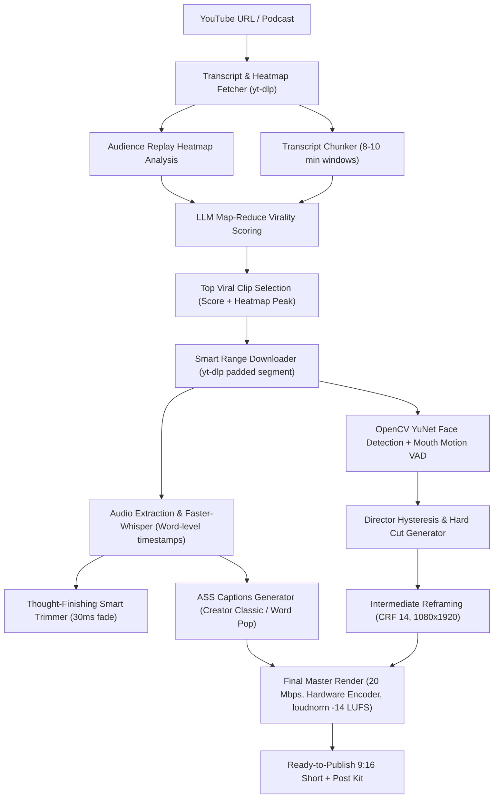

# ClipScout 🚀
> **Human-Grade AI Short-Form Video Producer for Podcasts & Long-Form Content**  
> *Turn hours of podcasts into viral, ready-to-publish 9:16 YouTube Shorts, Instagram Reels, and TikToks with speaker-aware cutting, audience heatmaps, and bold burned captions.*

[](https://opensource.org/licenses/MIT)
[](https://www.python.org/)
[](https://fastapi.tiangolo.com/)
[](https://vitejs.dev/)
[](https://ffmpeg.org/)
[](https://github.com/piyush-1803/ClipScout/actions)

---

## 🌟 Why ClipScout?

Most AI clipping tools produce dull, center-cropped 9:16 videos with robotic transcription and jittery face panning that viewers swipe past in seconds.

**ClipScout automates the actual workflow of a professional human video editor:**
1. **Audience-Validated Moment Discovery**: Blends LLM cognitive virality scoring with YouTube's real audience **Replay Heatmap peaks**.
2. **Thought-Finishing Smart Trim**: Snaps hook beginnings and extends clip endings until the speaker completely finishes their thought (&le; 90s, no cut mid-sentence).
3. **Speaker-Aware Reframing**: Tracks faces at 10 FPS with OpenCV YuNet ONNX, calculates mouth motion & audio VAD, and executes **crisp hard cuts** with director hysteresis (no nausea-inducing panning or premature speaker switching).
4. **Creator-Grade Auto-Captions**: Word-level Faster-Whisper transcription burned via high-visibility ASS subtitles (*Creator Classic* yellow-on-red, *Word Pop*, *Clean Outline*) with native **Hinglish** support.
5. **Instant Publishing Kit**: Auto-generates SEO titles, channel credits, descriptions with full episode links, tags, and suggested pinned comments.

---

## ⚡ Key Features

| Feature | Description |
| :--- | :--- |
| **🔥 Audience Heatmap Boost** | Analyzes YouTube's audience retention curve; candidate clips overlapping top replay peaks receive an automatic composite score boost. |
| **🎯 Active Speaker Tracking** | Local, zero-cost active speaker detection combining mouth-region optical motion with energy audio VAD. |
| **🎬 Human-Editor Cut Hysteresis** | Enforces minimum shot lengths (&ge; 1.5s), suppresses back-channel interjections (&lt; 1s), and applies dynamic punch-in zooms (1.08x vs 1.24x) on solo speakers to maximize retention. |
| **💬 Styled ASS Subtitles** | High-performance libass subtitle burning with bundled Montserrat ExtraBold, Poppins Bold, and Noto Sans Devanagari fonts. |
| **🇮🇳 Hinglish Romanization** | Translates Hindi audio into natural Latin Hinglish (e.g. *"kya", "nahi", "hai"*) while keeping English terms intact. |
| **⚡ Hardware Accelerated Export** | Auto-detects Intel QuickSync (`h264_qsv`), NVIDIA (`h264_nvenc`), and AMD (`h264_amf`) with graceful fallback to `libx264` (1080x1920, 60 FPS, 20 Mbps, EBU R128 `-14 LUFS` loudnorm). |
| **🛡️ YouTube YPP Fair Use Compliance** | Transforms content with face-tracking, attribution overlays (`Credit: Channel`), and fair-use safe harbor descriptions. |
| **🔐 Zero-Cost & Privacy-First** | Runs 100% locally on your machine. Bring Your Own Key (BYOK) for Google Gemini — keys remain stored only in your browser's `localStorage` and are never logged or stored by the backend. |

---

## 🏗️ System Architecture



---

## 🚀 Quick Start (Windows 11)

### Prerequisites
1. **Python 3.12, 3.13, or 3.14**: [python.org](https://www.python.org/)
2. **Node.js (v18+)**: [nodejs.org](https://nodejs.org/)
3. **FFmpeg with libass**:
   ```powershell
   winget install Gyan.FFmpeg
   ```
   *(Ensure `ffmpeg` and `ffprobe` are added to your system `PATH`).*

---

### 1-Click Launch

Clone the repository and double-click `start.bat`:

```powershell
git clone https://github.com/piyush-1803/ClipScout.git
cd ClipScout
.\start.bat
```

`start.bat` will automatically:
- Verify Python and Node.js environments.
- Install backend dependencies (`fastapi`, `uvicorn`, `yt-dlp`, `faster-whisper`, `opencv-python-headless`).
- Install frontend packages (`npm install`).
- Launch the FastAPI server at `http://localhost:8000`.
- Launch the Vite frontend at `http://localhost:5173` and open your default browser.

---

### Manual Launch

**Backend:**
```powershell
cd ClipScout
pip install -r requirements.txt
py -m uvicorn backend.main:app --port 8000 --reload
```

**Frontend:**
```powershell
cd ClipScout/frontend
npm install
npm run dev
```

---

## 🔑 Free Gemini API Setup

ClipScout defaults to Google's ultra-fast **Gemini 2.5 Flash** model with full BYOK support:
1. Get a free API key at [Google AI Studio](https://aistudio.google.com/app/apikey).
2. Click **Set API Key** in the top navigation bar of ClipScout.
3. Paste your key and click **Test Connection**.
4. The key is stored locally in your browser (`localStorage`) and never touches any external database.

---

## 🧪 Testing

ClipScout includes a comprehensive test suite covering face tracking, director hysteresis state machines, ASS caption generation, audio trimming, and YouTube heatmap blending:

```powershell
py -m pytest -v tests/
```

Expected output:
```text
tests/test_analyzer.py::test_calculate_weighted_score PASSED
tests/test_analyzer.py::test_heatmap_bonus PASSED
tests/test_captions.py::test_caption_line_splitting PASSED
tests/test_captions.py::test_ass_file_generation PASSED
tests/test_shots.py::test_director_hysteresis_cut PASSED
tests/test_shots.py::test_solo_speaker_punch_in PASSED
...
====================== 26 passed in 14.08s ======================
```

---

## 📂 Project Structure

```
ClipScout/
├── backend/
│   ├── main.py              # FastAPI application & REST endpoints
│   ├── analyzer.py          # LLM Map-Reduce virality scoring & heatmap fusion
│   ├── downloader.py        # Padded segment downloader
│   ├── transcript.py        # Multi-tiered YouTube transcript extraction
│   └── render/
│       ├── engine.py        # Master SSE job queue & ffmpeg export pipeline
│       ├── faces.py         # OpenCV YuNet ONNX face detection & tracking
│       ├── speaker.py       # Mouth motion optical flow & audio energy VAD
│       ├── shots.py         # Director hysteresis cuts & punch-in zoom
│       ├── reframe.py       # 9:16 canvas crop & blurred background generator
│       ├── transcribe.py    # Faster-Whisper word timestamps & Hinglish logic
│       ├── captions.py      # ASS subtitle generation & style presets
│       └── fonts/           # Bundled open-license fonts (Montserrat, Poppins)
├── frontend/
│   ├── src/
│   │   ├── components/      # UI components (VideoHeader, ClipCard, ShortsPreviewModal)
│   │   └── App.jsx          # Studio workspace & real-time SSE progress
│   └── package.json
├── tests/                   # 26 automated unit and integration tests
├── .github/workflows/       # CI GitHub Actions pipeline
├── start.bat                # 1-click launcher for Windows
└── README.md
```

---

## ⚖️ License & Fair Use Notice

Distributed under the **MIT License**. See `LICENSE` for more information.

ClipScout is designed to facilitate fair-use editorial short-form commentary, highlights, and educational snippets. Always ensure compliance with YouTube's Terms of Service and attribute original content creators.

---

## 👤 Author & Support

- **Author**: Piyush
- **GitHub**: [@piyush-1803](https://github.com/piyush-1803)
- **Contact**: `youknowwhat1803@gmail.com`
- **Repository**: [https://github.com/piyush-1803/ClipScout](https://github.com/piyush-1803/ClipScout)

⭐ *Star ClipScout on GitHub if it helped streamline your content creation workflow!*
